# Uber / Ride-Sharing Operations Analytics — New York City 2014–2015

Operations analysis of **18.8 million real Uber pickups** in New York City
(4,534,327 in Apr–Sep 2014 and 14,270,479 in Jan–Jun 2015), released by the NYC Taxi & Limousine
Commission: when and where demand happens, how fast it grows, how many vehicles were active, and how Uber compared
with taxis and Lyft.

**Tools:** Python (pandas, NumPy, Matplotlib, Seaborn) · SQL (PostgreSQL) · Excel · Power BI · Jupyter

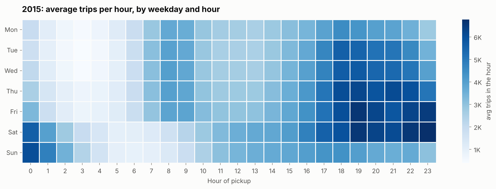

---

## Business problem

A ride-hailing operations team has to put **the right number of drivers in the right place at the right time**. Too
few drivers means long waits and lost trips; too many means idle drivers and wasted incentives. The team needs to know
how demand moves across hours, weekdays, holidays and areas, how fast it grows, and how productive the fleet is.

## Objectives

1. Measure demand: trips per day, monthly growth and year-over-year growth.
2. Find the demand patterns: peak hours, weekdays vs weekends, holidays and weather shocks.
3. Map demand: boroughs, zones, airports, and where it grows fastest.
4. Measure supply: active vehicles and trips per active vehicle per day (by base and weekday).
5. Put Uber in market context (yellow taxis, Lyft) and recommend actions.

## Dataset

| | |
|---|---|
| Name | Uber TLC FOIL response — Uber pickups in NYC + TLC summary files |
| Source | NYC Taxi & Limousine Commission, released to FiveThirtyEight under a Freedom of Information Law request; published at [fivethirtyeight/uber-tlc-foil-response](https://github.com/fivethirtyeight/uber-tlc-foil-response) (also on Kaggle as *Uber Pickups in New York City*) |
| Size | 18,804,806 pickups + daily vehicle counts (Jan–Feb 2015) + TLC market summary (Jul–Sep 2014) |
| Provenance | Downloaded from the publisher's repository at a pinned commit; every file checked with SHA-256 — see [`data/raw/SOURCE.md`](data/raw/SOURCE.md). The TLC's own daily totals match the 2014 pickup rows on 92/92 days. |
| Large files | The 7 trip files (280 MB) are not stored in Git: `python scripts/download_data.py` downloads and verifies them |

**Not in this data (not invented):** fares, revenue, surge pricing, profit, trip distance and duration, drop-off
locations, cancellations, waiting times, ratings and driver hours. **Driver utilization cannot be calculated**;
*trips per active vehicle per day* is used as a clearly labelled productivity proxy.

## Project architecture

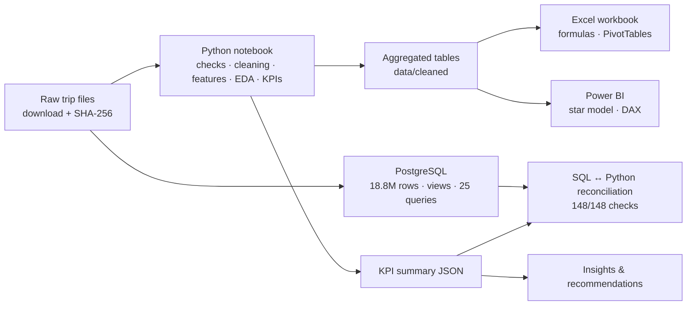

## Data cleaning (summary)

* Parsed two different timestamp formats; joined 2015 taxi zones to boroughs; separated the airports (JFK, LaGuardia, Newark).
* **Identical rows were tested, not deleted blindly:** the TLC's daily totals match the 2014 rows only when they are kept
  (92/92 days). In 2015 timestamps lose their seconds in March; a possible
  ~1.8% overcount is documented.
* Flagged pickups outside NYC (0.66% of 2014), the partial last day of 2014 and the
  daylight-saving gap; filled 162,195 missing affiliated bases with "Unknown".
* **Rejected a misleading source:** the 2015 base report of other car services changes from about
  59 to 202 reporting bases per day, so it is not used for market share.

Details: [`docs/data_cleaning.md`](docs/data_cleaning.md) · log: [`reports/cleaning_log.csv`](reports/cleaning_log.csv)

## SQL analysis (PostgreSQL)

[`sql/schema.sql`](sql/schema.sql) · [`sql/load_data.sql`](sql/load_data.sql) (staging → typed tables, 18.8M rows in under 2 minutes) ·
[`sql/analysis_views.sql`](sql/analysis_views.sql) (views + materialized views) · [`sql/analysis_queries.sql`](sql/analysis_queries.sql) — **25 queries**:
GROUP BY, CASE, INNER/LEFT/FULL OUTER JOIN, anti-join, subqueries, CTEs, `FILTER`, `ROLLUP`, `PERCENTILE_CONT`,
`LAG`, moving averages, running totals, `RANK`, `DENSE_RANK`, `ROW_NUMBER`, `FIRST_VALUE` ·
[`sql/business_questions.md`](sql/business_questions.md) (question + result per query) ·
**reconciliation 148/148** ([report](reports/sql_python_reconciliation.md)) — SQL recomputes every KPI from the raw trips.

## Python analysis

[`notebooks/uber_operations_analysis.ipynb`](notebooks/uber_operations_analysis.ipynb) — executed end to end (21 sections):
loading, shape and types, missing values, duplicate tests against TLC totals, data-quality checks, logged cleaning,
feature engineering, descriptive statistics, EDA, KPIs, growth trends, time / geography / base / supply / market
segments, correlation, a pickup density map, findings and recommendations.

## Excel workbook

[`excel/uber_operations_analysis.xlsx`](excel/uber_operations_analysis.xlsx) (1.0 MB): aggregated data as Excel Tables with
helper formulas (`CHOOSE`/`WEEKDAY`, `IFS` time bands, `VLOOKUP`), analysis sheets built with `SUMIFS`, `COUNTIFS`,
`AVERAGEIFS`, `MINIFS`, `XLOOKUP` (with fallback), `INDEX/MATCH`, `LARGE/SMALL`, `RANK.EQ`, `PERCENTILE.INC`, `CORREL`,
`EDATE`; a weekday × hour heat map, holiday/storm effect table, zone ranking, **native PivotTables**, charts and a ✓/✗
check of every KPI against Python. Verified by a full recalculation: **69/69 checks passed**
([report](reports/excel_verification.md)).

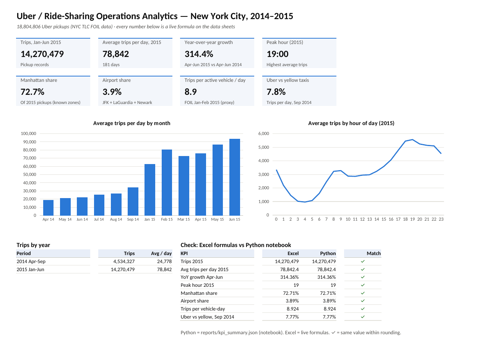
*Summary sheet of the workbook — rendered from the actual `.xlsx` file with LibreOffice.*

## Power BI dashboard

[`powerbi/Uber_NYC.pbix`](powerbi/Uber_NYC.pbix) — 3-page dashboard built in Power BI Desktop on a star schema
(daily, hourly, zone, base, fleet and market facts; zone, base and date dimensions) with **44 DAX measures** (YoY, 7-day average, peak hour, area shares, trips per active vehicle, Top-N):
**Executive Overview · Detailed Analysis · Business Insights**, with synced Period and Day type slicers.
Model, refresh steps and expected values: [`powerbi/README.md`](powerbi/README.md).

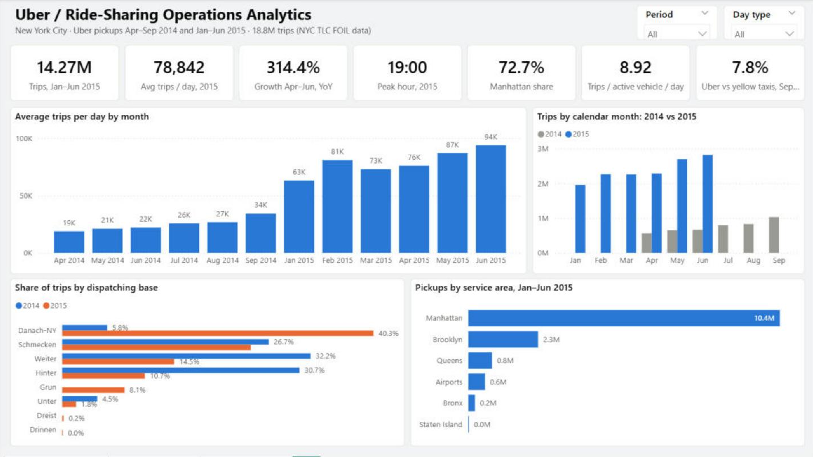

## KPIs

| KPI | Value | KPI | Value |
|---|---|---|---|
| Trips (Apr–Sep 2014 / Jan–Jun 2015) | 4.5M / 14.3M | Year-over-year growth (Apr–Jun) | +314.4% (4.1×) |
| Avg trips per day 2015 | 78,842 | Growth Jan → Jun 2015 (per day) | +49.0% |
| Peak hour / quietest hour | 7–8 pm / 4–5 am | Peak-to-trough ratio | 5.8× |
| Manhattan share (2015) | 72.7% | Airport share (2015) | 3.9% |
| Avg active vehicles per day (Jan–Feb 2015) | 7,845 | Trips per active vehicle per day | 8.9 |
| Uber vs yellow-taxi trips (Sep 2014) | 7.8% | Uber vs Lyft (Sep 2014) | 8.9× |

## Key insights

1. **Demand quadrupled in a year:** Apr–Jun 2015 = 4.1× Apr–Jun 2014; trips per day still grew +49% from January to June 2015.
2. **Evening peak:** the busiest hour (7–8 pm) is 5.8× the 4–5 am trough; weekdays carry 25.9% of trips between 4 and 8 pm.
3. **Weekend nights are a different market:** 21.4% of weekend trips start between midnight and 6 am (weekdays 8.8%).
4. **Saturday is busiest** (92,868 trips/day), **Monday quietest** (65,164).
5. **Holidays and storms cut demand:** federal holidays averaged -23% vs a normal day; the blizzard travel-ban day had -60%.
6. **Outer boroughs grow faster:** Bronx +124%, Queens +95%, Brooklyn +61% vs Manhattan +41% (Jan → Jun 2015).
7. **Concentrated demand:** 25 of 260 zones produce half of all pickups; airports 3.9% (3,068/day).
8. **Fleet productivity:** ≈8.9 trips per active vehicle per day (9.9 at weekends); the active fleet grew +16% from the first to the last full week (6 weeks apart).

All 12 insights: [`reports/insights.md`](reports/insights.md)

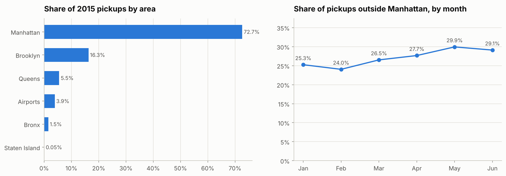

## Business recommendations

1. Plan driver supply around the 4–8 pm peak and Friday/Saturday nights; stop paying incentives in the 3–6 am trough.
2. Recruit ahead of growth — demand per day grew +49% in five months.
3. Run an airport playbook (positioning and queues by hour) for JFK and LaGuardia.
4. Add incentives and marketing in Brooklyn, Queens and the Bronx, where demand grows fastest.
5. Keep holiday and severe-weather playbooks with lower supply targets.
6. Track trips per active vehicle by base every week.
7. Collect fares, durations, driver online hours and cancellations to measure revenue and true utilization.

## How to run

```bash
pip install -r requirements.txt
python scripts/download_data.py                                  # ~280 MB, SHA-256 verified
jupyter notebook notebooks/uber_operations_analysis.ipynb        # Restart & Run All (needs ~4 GB RAM)

createdb uber_db                                                 # PostgreSQL 13+, run from the project root
psql -d uber_db -f sql/schema.sql
psql -d uber_db -f sql/load_data.sql                             # loads 18.8 M rows (about 2 minutes)
psql -d uber_db -f sql/analysis_views.sql
python scripts/run_sql_queries.py --db uber_db                   # saves results to sql/results/
python scripts/reconcile_sql_python.py                           # SQL vs Python check
```

## Folder structure

```text
uber-ride-sharing-operations-analytics/
├── README.md · requirements.txt · .gitignore
├── data/raw/           # small raw files + SOURCE.md + SHA256SUMS.txt (large trip files: scripts/download_data.py)
├── data/cleaned/       # aggregated, analysis-ready tables (hourly, daily, base, zone, area, FOIL, market, dims)
├── notebooks/          # uber_operations_analysis.ipynb (executed)
├── sql/                # schema, load, views, 25 queries, business_questions.md, results/
├── excel/              # uber_operations_analysis.xlsx
├── powerbi/            # Uber_NYC.pbix (3-page dashboard), measures.dax, power_query.m
├── reports/            # insights.md, kpi_summary.json, cleaning log, data-quality checks, SQL reconciliation, Excel verification, figures/
├── docs/               # data_dictionary.md, data_cleaning.md, methodology.md
├── scripts/            # download_data.py, run_sql_queries.py, reconcile_sql_python.py
└── screenshots/        # Power BI pages + Excel Summary
```

## Screenshots

| | |
|---|---|
| 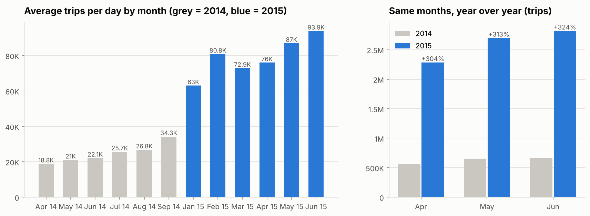 | 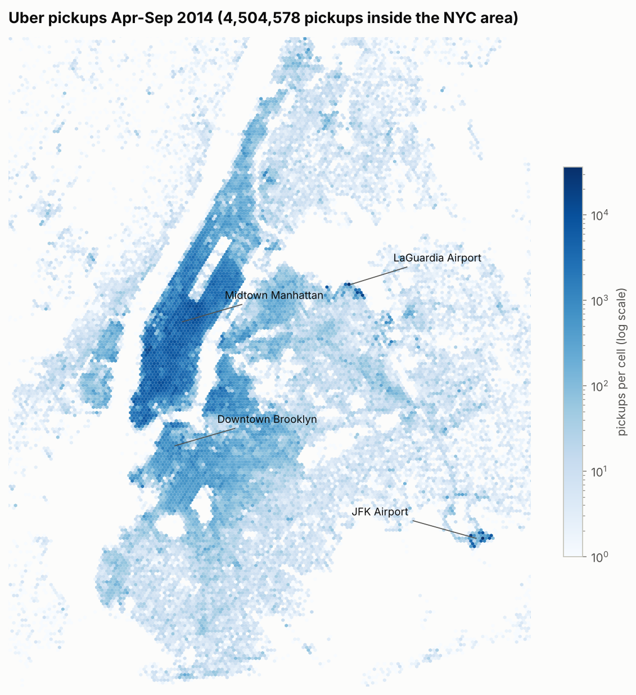 |
| 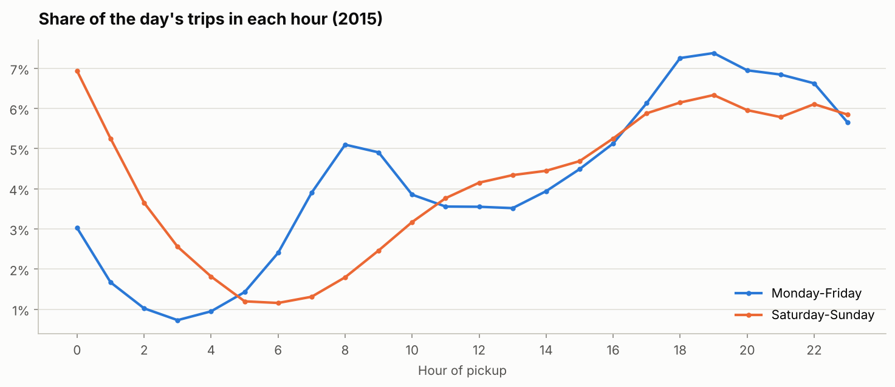 | 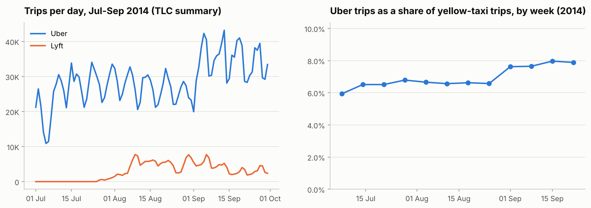 |
| 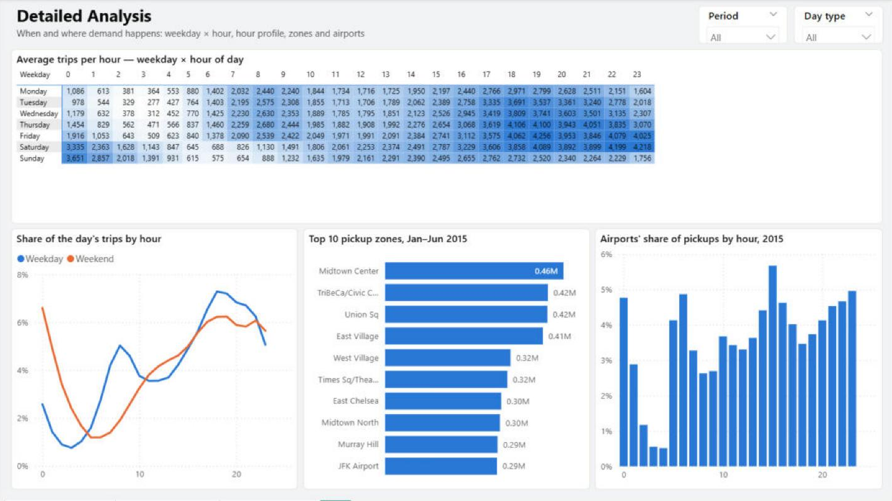 | 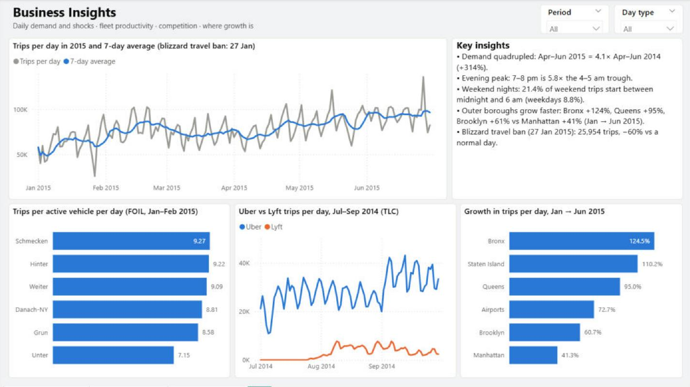 |

## Limitations

* Pickup records only — no fares, distance, duration, drop-offs, cancellations, waiting times or driver hours.
* 2014 (Apr–Sep) and 2015 (Jan–Jun) cover different months; only Apr–Jun can be compared year over year.
* 2015 may include about 1.8% double records; the FOIL vehicle file covers only Jan–Feb 2015.
* Market comparisons use TLC summary tables; market share against other car services in 2015 is not calculated (coverage changes).

## Future improvements

* Add NYC weather data to model demand against rain, snow and temperature.
* Forecast hourly demand by zone (e.g. seasonal baseline + growth) to set driver targets.
* Compare with yellow-taxi trip records for the same zones and hours.
* Add the trip-level files of other car services to study competition.

---
*Author: Jatin Gohel · Data: NYC TLC via FiveThirtyEight · All numbers come from `reports/kpi_summary.json` and `sql/results/`.*
